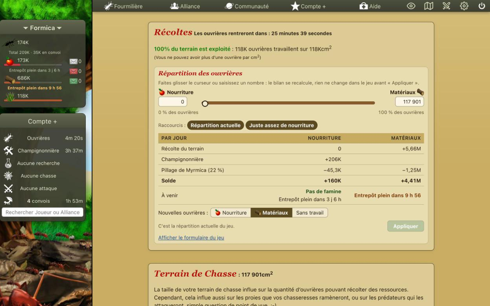
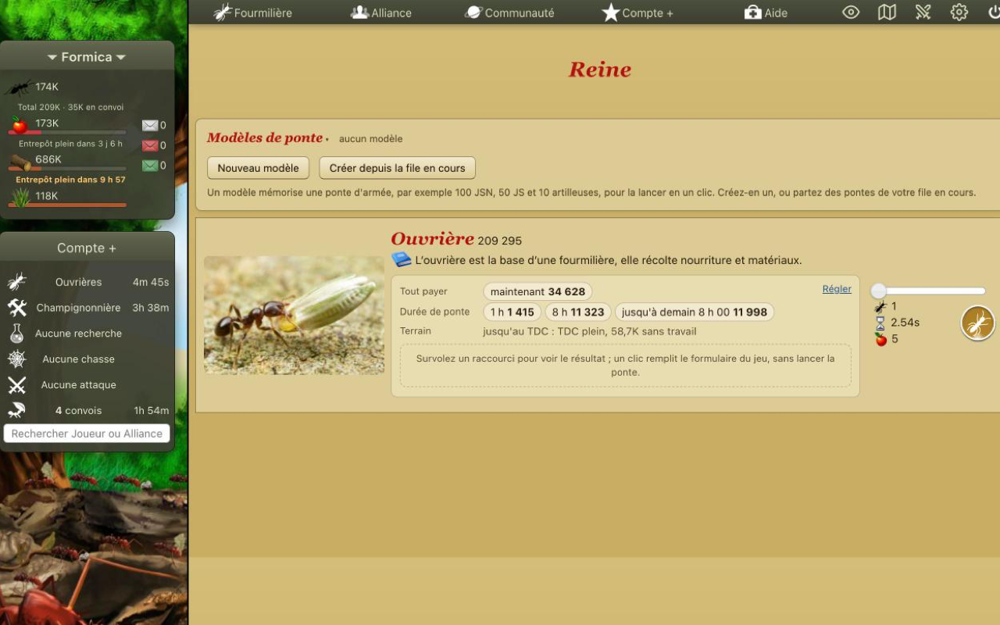
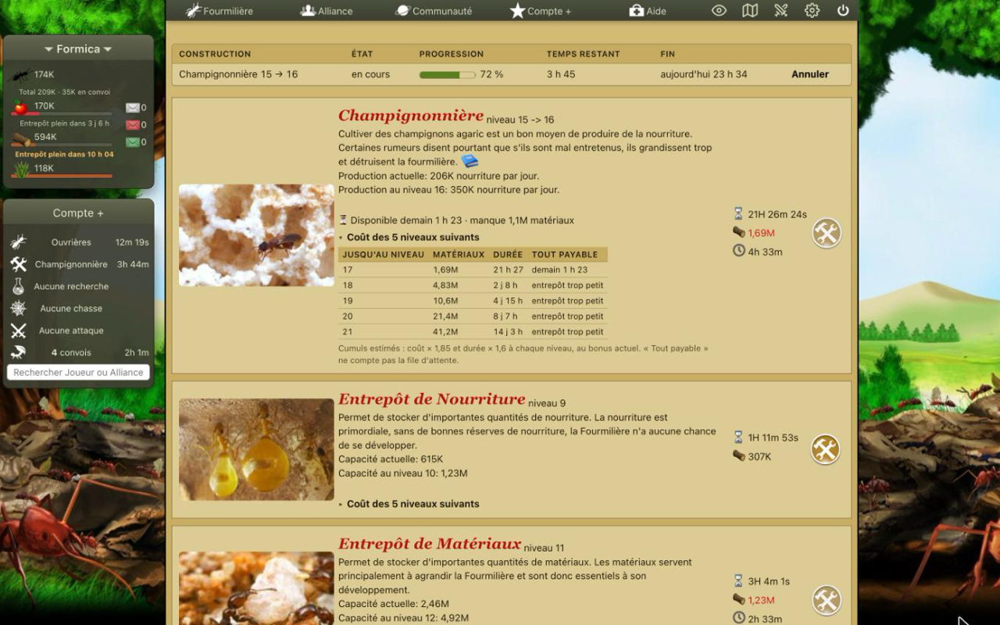

<p align="center"></p>

<h1 align="center">Optizzz</h1>

<p align="center">
  Extension Chrome et Firefox qui ajoute des outils au jeu <a href="http://www.fourmizzz.fr">Fourmizzz</a>, directement dans ses pages.
</p>

<p align="center">
  <a href="https://chromewebstore.google.com/detail/optizzz/goeifkbimepccacjfkkmhjmhgoiigjpl"></a>
  <a href="https://addons.mozilla.org/fr/firefox/addon/optizzz/"></a>
  <a href="LICENSE"></a>
</p>

<p align="center"></p>

<p align="center">
  
  
</p>

## Installer

| Navigateur                                        | Lien                                                                                                  |
| ------------------------------------------------- | ----------------------------------------------------------------------------------------------------- |
| Chrome, Edge, Brave, Opera (navigateurs Chromium) | [Chrome Web Store](https://chromewebstore.google.com/detail/optizzz/goeifkbimepccacjfkkmhjmhgoiigjpl) |
| Firefox (ordinateur et Android)                   | [Firefox Add-ons](https://addons.mozilla.org/fr/firefox/addon/optizzz/)                               |

Une fois installée, ouvrez une page du jeu : les outils apparaissent d'eux-mêmes. Chacun se désactive dans « Fonctionnalités » (roue dentée dans la barre du jeu, ou icône de l'extension).

## Fonctionnalités

### Votre fourmilière

- **Chantiers en cours** : tableau des constructions et recherches, avec progression et heure de fin.
- **Heures de fin** : l'heure de fin des chasses, pontes et chantiers à côté des décomptes, et un encart « Prochaines fins ».
- **Prévisions de ressources** : quand vous pourrez payer, quand vous tomberez en famine, quand un entrepôt sera plein, le coût des niveaux suivants, et un simulateur de répartition des ouvrières.
- **Conseils** : sur Construction et Laboratoire, ce qu'il vaut mieux faire d'abord (Armes ou ponte, attendre Architecture, la ponte la moins chère à accélérer, l'Étable à pucerons…).
- **Alertes** : sur l'icône de l'extension, le temps avant une famine ou un entrepôt plein pour tous vos serveurs, et des notifications au choix.
- **Planificateur de ponte** : sur la Reine, des raccourcis (tout payer, durée de ponte, bilan à zéro) avec aperçu, et la fin, le paiement et l'entretien de la ponte choisie.
- **Modèles de ponte** : mémorisez une ponte d'armée et relancez-la en un clic.
- **Calculateur de convoi** : trajet, heure d'arrivée, destinataires suggérés, ce que vous avez livré et reçu par joueur, et le total de vos ouvrières convois compris.
- **Rechargement sans risque** : recharger une page ou revenir en arrière ne relance plus une ponte, une chasse ou une construction.
- **Nombres arrondis** (à activer) : les grands nombres écrits en court (12,3K, 1,23M), la valeur exacte au survol.

### Chasse et combat

- **Lanceur de chasse** : sur Ressources, combien chasser et avec quoi, puis lancer en un clic.
- **Rapports de chasse** : dans la messagerie, un tableau des combats de chaque chasse avec les pertes prévues.
- **Rapports d'attaque** : armées, pertes, Armes adverses et butin de chaque attaque, à rejouer dans le simulateur.
- **Simulateur de combat** : par-dessus le jeu, depuis la barre du haut ou l'icône de l'extension.
- **Cibles à portée** : sur Ennemies, les joueurs attaquables triés par distance, avec trajet, état, pactes et guerres.
- **Plan de flood** : les attaques qui prennent le plus de TDC avec votre armée ; un bouton remplit le formulaire, vous validez vous-même.
- **Attaques en cours** : une liste lisible avec décompte, heure d'arrivée, lieu et troupes, et un bouton pour copier chacune.
- **Sondes** : une fourmi gardée sur le Dôme et la Loge (et le Terrain si vous le voulez) pour que le rapport d'une attaque montre l'armée de l'attaquant.
- **Production sur les profils** : ce que le TDC d'un joueur récolte par jour au plus.

### Alliance et serveur

- **Carte de l'alliance** : les membres reliés à leurs plus proches voisins, avec les temps de trajet.
- **Carte du serveur** : situer des joueurs et des alliances (vos pactes, vos guerres) sur tout le serveur, avec distances et trajets.
- **Colonnes de la page Membres** : le trajet vers chaque membre et son rôle dans la chaîne de TDC, triables.
- **Chaîne de TDC** : qui peut prendre à qui, les rôles et l'ordre des floods pour faire monter le TDC.
- **Historique de progression** : les courbes du TDC et des scores dans le temps, pour vous, votre alliance et sur chaque profil.
- **Statistiques d'alliance** : les totaux de l'alliance maintenant et dans le temps, comparés à d'autres alliances.
- **Suivis** : ce qui a changé chez les joueurs et alliances que vous suivez (alliance, TDC, guerres, pactes) depuis votre dernière visite.
- **Partage d'alliance** : copiez votre état pour le coller sur le Discord de l'alliance, et lisez celui des autres membres.

Les cartes, l'historique et les suivis s'appuient sur l'[API publique des exports](https://s5.fourmizzz.fr/developer.php) du jeu.

### Apparence

Optizzz retouche aussi l'apparence du jeu, sans changer ses couleurs ni ses images : texte plus lisible, tableaux et menus plus nets, et des pages adaptées au téléphone, à la tablette et aux grands écrans. Les couleurs des outils restent lisibles par les daltoniens.

Le détail de chaque outil est dans [`docs/features/`](docs/features/).

## Optizzz ne joue pas à votre place

Les formulaires du jeu ne sont envoyés que lorsque vous cliquez : une chasse n'est lancée, une répartition appliquée et une attaque remplie qu'à votre demande. Les sondes ne sont déplacées qu'à votre clic ou juste après une chasse ou une attaque que vous avez envoyée.

## Confidentialité

Aucune donnée n'est collectée ni envoyée ailleurs que vers Fourmizzz. Vos réglages restent dans votre navigateur, et le partage d'alliance passe uniquement par votre copier-coller. Voir [PRIVACY.md](PRIVACY.md).

## Développement

Prérequis : Node.js 24+ et pnpm 12.

```bash
pnpm install
pnpm dev            # Chrome, rechargement à chaud
pnpm dev:firefox    # Firefox
pnpm test           # tests (vitest)
pnpm lint && pnpm typecheck
```

Le code est en TypeScript, empaqueté par [WXT](https://wxt.dev) (Vite), avec React et Apache ECharts pour les vues les plus riches. Pour s'y retrouver :

- [`CLAUDE.md`](CLAUDE.md) : architecture, conventions et commandes ;
- [`docs/features/`](docs/features/) : une page par outil ;
- [`docs/research/`](docs/research/) : ce qu'on sait du jeu (exports, sélecteurs, temps de trajet) ;
- [`docs/adr/`](docs/adr/) : décisions d'architecture ;
- [`docs/design-system.md`](docs/design-system.md) : composants et jetons de l'interface ;
- [`docs/publication.md`](docs/publication.md) : publier une version.

Les commits suivent [Conventional Commits](https://www.conventionalcommits.org/fr/) ; le hook `pre-commit` lance le lint, le typecheck et les tests.

### Construire l'extension (instructions pour la relecture AMO)

```bash
pnpm install --frozen-lockfile
pnpm build:firefox  # résultat : .output/firefox-mv3/
pnpm build          # Chrome : .output/chrome-mv3/
```

Aucun code distant n'est chargé.

## Crédits

Inspiré de [Toolzzz](https://github.com/GuiEpi/toolzzz) et d'[Outiiil](https://github.com/Hraesvelg/Outiiil). La formule du temps de trajet provient de Toolzzz.

Optizzz est un projet de joueur, non affilié à Fourmizzz.

## Licence

[MIT](LICENSE)
